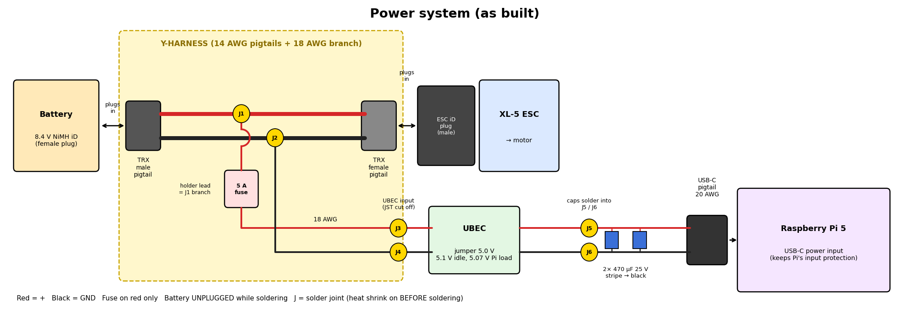

# Hardware

Traxxas brushed chassis (XL-5 ESC), Raspberry Pi 5 (Ubuntu 24.04, ROS 2 Jazzy), STM32
Nucleo-F446RE, Slamtec RPLIDAR C1.

Three environments, two ROS distros that **cannot talk to each other**:

| Where | OS | ROS 2 | Used for |
|---|---|---|---|
| Docker container `f1tenth_sim` | Ubuntu 20.04 | Foxy (EOL) | the F1TENTH sim only |
| Raspberry Pi 5 (`carpi`) | Ubuntu 24.04 Server | Jazzy | drivers, SLAM, eventually everything on the car |
| WSL (native, not in Docker) | Ubuntu 24.04 | Jazzy desktop | RViz / viewing the Pi's topics |

The Pi 5 needs Ubuntu 24.04: older kernels don't support its RP1 I/O chip, and 24.04 pins
you to Jazzy. That's why the real car and the sim are on different distros.

---

## M3 result — real LiDAR + handheld SLAM map


RPLIDAR C1 on the Pi publishing `/scan`, viewed live in RViz on the desktop, and a
slam_toolbox map built by carrying the LiDAR around a room.

The map has a **rotated duplicate of the room** overlaid on itself. That's expected for
handheld mapping with no odometry, not a bug in the setup (see
[why the room doubled](#why-the-room-doubled)). Re-mapping by hand wasn't worth it — the
fix is real wheel odometry, which is M4. The proper map comes in M5, on the car.

---

## Pi setup

### Flashing

Raspberry Pi Imager → **Ubuntu Server 24.04 LTS (64-bit)**. In the OS customization screen:

- hostname `carpi`, user `gphan`
- Wi-Fi SSID/password and country
- SSH enabled, **public-key auth only**, paste `~/.ssh/id_ed25519.pub` from WSL
  (the `.pub` — never the private key)

Running on a 16 GB card (the 128 GB one wouldn't boot). Enough for `ros-base` plus the
workspace; move to a bigger card or SSD if logs/bags fill it.

First boot takes a few minutes (cloud-init runs, resizes the filesystem, then may reboot).
Green LED flickering = SD activity, good. Solid red only = power but not booting.

### SSH from WSL

`~/.ssh/config`:

```
Host carpi
    HostName carpi.local
    User gphan
```

Then just `ssh carpi`. Notes:

- `Permission denied (publickey)` was the **wrong username** (WSL user ≠ Pi user), not a key
  problem.
- `carpi.local` (mDNS) only resolves from WSL with mirrored networking (below).
- After a re-flash the host key changes and SSH refuses to connect:
  `ssh-keygen -R carpi.local`.

### The `noble-updates` fix

`apt install ros-jazzy-ros-base` failed with unmet dependencies (`liblz4-dev`,
`libzstd-dev`, ...). Cause: the image's `/etc/apt/sources.list.d/ubuntu.sources` only listed
the `noble` suite. ROS packages are built against the **updated** versions of those
libraries, which live in `noble-updates`.

Ubuntu splits each release into suites:

| Suite | Contains |
|---|---|
| `noble` | packages as frozen at release |
| `noble-updates` | bug-fix updates since release |
| `noble-security` | security fixes |
| `noble-backports` | newer versions backported (opt-in) |

Diagnose with `apt-cache policy liblz4-1` — if the installed version comes from a suite not
in your sources, that's it. Fix:

```bash
sudo sed -i 's/^Suites: noble$/Suites: noble noble-updates noble-backports/' \
  /etc/apt/sources.list.d/ubuntu.sources
sudo apt update && sudo apt full-upgrade -y
```

(ARM boards pull from `ports.ubuntu.com`, not `archive.ubuntu.com` — same suites.)

### ROS 2 Jazzy

Standard ROS apt repo setup, then:

```bash
sudo apt install -y ros-jazzy-ros-base ros-dev-tools     # ros-base: no GUI, Pi is headless
sudo rosdep init && rosdep update
echo "source /opt/ros/jazzy/setup.bash" >> ~/.bashrc
```

Note the package name is `ros-jazzy-ros-base` (dashes), not `ros_base`.

### Temperatures

CanaKit case with fan. `vcgencmd measure_temp` — idle ~45 °C, LiDAR + SLAM well under the
80 °C throttle point. Check `vcgencmd get_throttled` (want `0x0`) if things get slow;
non-zero also flags undervoltage, which matters once it's on battery.

---

## LiDAR driver

```bash
mkdir -p ~/car_ws/src && cd ~/car_ws/src
git clone https://github.com/Slamtec/sllidar_ros2.git
cd ~/car_ws && rosdep install --from-paths src -y --ignore-src
colcon build --symlink-install
echo "source ~/car_ws/install/setup.bash" >> ~/.bashrc
```

Build warnings from the vendored SDK are harmless.

### Serial access

The C1 ships with a CP2102 USB-UART adapter → shows up as `/dev/ttyUSB0`.

```bash
sudo usermod -aG dialout $USER     # then log out and back in — groups apply at login
ls -l /dev/ttyUSB0
```

No `/dev/ttyUSB0`? Check `dmesg | tail` while plugging in. Mine was the USB-C end into the
adapter **not fully seated** — it powered nothing and enumerated nothing.

### Run it

```bash
ros2 launch sllidar_ros2 sllidar_c1_launch.py serial_port:=/dev/ttyUSB0
ros2 topic hz /scan      # second shell: ~10 Hz
```

The motor spins up when the driver starts. Scans are published in frame `laser`.

---

## Viewing the Pi's topics from WSL

Install the desktop variant in WSL (native, **not** in the Foxy container — Foxy can't see
Jazzy):

```bash
sudo apt install -y ros-jazzy-desktop
```

### Networking

ROS 2 discovery uses UDP multicast, which WSL's default NAT network drops. Two pieces:

1. `C:\Users\<you>\.wslconfig`:
   ```ini
   [wsl2]
   networkingMode=mirrored
   ```
2. Hyper-V firewall lets inbound traffic into WSL — PowerShell **as admin**:
   ```powershell
   Set-NetFirewallHyperVVMSetting -Name '{40E0AC32-46A5-438A-A0B2-2B479E8F2E90}' -DefaultInboundAction Allow
   ```

Then `wsl --shutdown` and reopen. Check: `ip addr` in WSL should show your real LAN IP
(same subnet as the Pi), not `172.x`.

Both machines must be on the same network and the same `ROS_DOMAIN_ID` (default 0).

### Check and view

```bash
ros2 topic list --no-daemon      # /scan should be there
rviz2
```

RViz: **Fixed Frame = `laser`** (there's no `map` or `base_link` yet), Add → By topic →
`/scan`.

If `ros2 topic list` shows nothing and `ros2 daemon stop` hangs, the CLI daemon cached an
empty graph from before networking was fixed: `pkill -f _ros2_daemon`, then use
`--no-daemon`.

### Reading a scan

The C1 is a DTOF (direct time-of-flight) sensor: it times a light pulse out and back, for
each angle, ~10 times a second. Each `sensor_msgs/LaserScan` is one revolution:

- `angle_min`, `angle_max`, `angle_increment` — which direction each sample points
- `ranges[]` — distance per angle in meters; `inf` = no return (too far, glass, black
  surfaces)
- `intensities[]` — return strength; RViz colors points by it by default

The dots in RViz are the walls/furniture at the LiDAR's height, seen from above. It's a 2D
slice — a table is invisible if the beam passes under it.

---

## Handheld SLAM

Carry the LiDAR around, slam_toolbox stitches scans into a map. Four shells on the Pi:

```bash
# 1. driver
ros2 launch sllidar_ros2 sllidar_c1_launch.py serial_port:=/dev/ttyUSB0

# 2. fake odometry: odom -> base_link fixed (we have no wheels yet)
ros2 run tf2_ros static_transform_publisher --frame-id odom --child-frame-id base_link

# 3. LiDAR mounted at base_link
ros2 run tf2_ros static_transform_publisher --frame-id base_link --child-frame-id laser

# 4. SLAM
ros2 launch slam_toolbox online_async_launch.py \
  slam_params_file:=$HOME/car_ws/config/mapper_real.yaml use_sim_time:=false
```

Note Jazzy's argument is `slam_params_file`; Foxy's was `params_file`.

`~/car_ws/config/mapper_real.yaml` is Jazzy's default `mapper_params_online_async.yaml`
with:

| Param | Value | Why |
|---|---|---|
| `base_frame` | `base_link` | default is `base_footprint`, which doesn't exist |
| `use_sim_time` | `false` | real hardware, wall clock |
| `minimum_travel_distance` | `0.0` | odometry never moves, so the default threshold would never add a scan |
| `minimum_travel_heading` | `0.0` | same |

Hold the LiDAR **level, motor axis vertical**, and turn slowly. In RViz set Fixed Frame
`map`, add `/map`.

### Why the room doubled

slam_toolbox doesn't search every possible pose for a new scan. It starts from the
odometry's guess of how far you moved and searches a limited window around it
(roughly ±20° of rotation). With the static `odom → base_link`, the guess is always
"didn't move". Rotate faster than that window between processed scans and the matcher
locks onto the wrong alignment — the room gets pasted in again, rotated.

This is the whole argument for wheel odometry + IMU (M4): a good motion guess is what keeps
scan matching in the right basin.

### Saving the map

```bash
sudo apt install -y ros-jazzy-nav2-map-server
mkdir -p ~/car_ws/maps
ros2 run nav2_map_server map_saver_cli -f ~/car_ws/maps/room_handheld
```

Produces `room_handheld.pgm` (the image: white free, black occupied, gray unknown) and
`room_handheld.yaml` (resolution, origin). Same name overwrites. Copy to the PC:

```bash
# from WSL
scp gphan@carpi.local:~/car_ws/maps/room_handheld.* ~/f1tenth_ws/src/car_bringup/maps/
```

Screenshot for the README: RViz view type **TopDownOrtho**, Fixed Frame `map`.

---

## Power (M4)

Bench: Pi on its official 27 W USB-C supply. On the car, the stock 8.4 V NiMH pack (≈9.8 V
fresh off the charger, sags toward 7 V under load) feeds everything. Built and verified
2026-10-17 — build sheet: .

```
 Battery ─► [TRX male] ══14 AWG══ J1/J2 ══14 AWG══ [TRX female] ─► XL-5 ESC ─► motor
                                   ║                  (ESC's BEC also powers the servo)
                          18 AWG, red via 5 A ATM fuse (holder right at J1)
                                   ║
                          Henge 8 A UBEC (jumper 5.0 V)
                                   ║
                   2 × 470 µF 25 V in parallel ─► USB-C pigtail ─► Pi 5 USB-C input
```

- **Y-harness** from TRX pigtails (DEVMO, 14 AWG) spliced 3-way at J1 (red) / J2 (black). The
  fuse holder's own 18 AWG lead is J1's third wire, so the unfused section is ~5 cm. Everything
  after the fuse can be any length.
- **USB-C, not GPIO:** feeding 5 V through the header bypasses the Pi's input protection, and
  dupont pins are only good for ~1–1.5 A.
- **Caps** at the UBEC output, polarity by the stripe (legs trimmed, so the long-leg mark is gone).
- **Common ground** between ESC, servo, STM32 and Pi — PWM is referenced to it.
- Traxxas parallel harness #3064X is 1/16-scale only (gauge unpublished) and the series
  harnesses (#3063 and clones) are wrong entirely — neither used.

**Verification (battery, ESC unplugged):**

| Check | Result |
|---|---|
| Continuity red ↔ black at TRX and at USB-C | open ✓ |
| UBEC output, no load | 5.1 V |
| Pi 5 under `stress-ng --cpu 4`, 3 min | `get_throttled` = **0x0**, `EXT5V_V` = **5.07 V**, 76 °C |

`vcgencmd pmic_read_adc EXT5V_V` is the Pi 5 measuring its own 5 V input — the best check of
sag under load. On Ubuntu `vcgencmd` needs `/dev/vcio`: `sudo usermod -aG video $USER`, re-login.

**PSU_MAX_CURRENT:** a bare USB-C pigtail can't do USB-PD, so the Pi assumes a weak supply and
caps USB peripherals at 600 mA. The UBEC is rated 8 A, so tell the Pi it's a 5 A supply:
`sudo rpi-eeprom-config --edit` → `PSU_MAX_CURRENT=5000` → reboot.

**To do:** boot current on the bench supply (needs banana leads), then the same stress test
with the LiDAR and Nucleo plugged in. 76 °C at full load with the fan at full speed is
warm — check the cooler's seating.

## Traxxas XL-5 notes

- Servo-style PWM: 1.0 ms full reverse/left, **1.5 ms neutral**, 2.0 ms full forward/right,
  at 50 Hz.
- **Calibration** maps the ESC to the transmitter's (later: the STM32's) neutral and
  endpoints. Redo it once the STM32 drives it — its 1.5 ms won't match the stock radio's.
  Procedure: hold the set button with neutral applied, then full throttle, full reverse,
  release per the Traxxas manual's LED sequence.
- **Training mode** caps power at ~50%. Leave it on for first autonomy runs.
- **Low-voltage detection:** stock pack is an 8.4 V 7-cell NiMH, so LVD **off**. NiMH tolerates
  deep discharge and LVD's LiPo cutoff (~6 V) would trigger on sag under load. Turn it **on** if
  the car ever moves to LiPo — over-discharge ruins those.

---

## Firmware (M4)

Pins, receiver-replacement wiring, the BNO055 driver and open firmware items: [firmware.md](firmware.md).

## M4 plan

Order of work, each step testable on its own:

1. ~~Power harness (above), Pi running off the battery, `get_throttled` = `0x0`~~ ✓ 2026-10-17
2. STM32: servo PWM, sweep steering
3. STM32: ESC PWM, recalibrate the XL-5, wheels off the ground
4. Traxxas RPM sensor → timer input capture → wheel speed
5. ~~BNO055 IMU over I2C (own register-level driver in `firmware/lib/bno055/`, IMU mode)~~ ✓
   driver + host unit tests done ([firmware.md](firmware.md))
6. micro-ROS on the STM32: subscribe `/drive`, publish wheel speed + IMU
7. `robot_localization` EKF fuses wheels + IMU → `odom → base_link`
8. URDF from the measurements below (replaces the static transforms)

Later (backlog):

- **Battery monitoring.** INA226 (I2C voltage + current) on the battery side → STM32 →
  `sensor_msgs/BatteryState` over micro-ROS; show it in RViz/Foxglove, low-battery warning.
  Coulomb counting (integrate current) rather than voltage-to-percent — NiMH's discharge curve
  is too flat for voltage alone to say much. Cheapest first step: resistor divider into an
  STM32 ADC pin for voltage only.

Parts:

| Part | Status |
|---|---|
| Traxxas #6520 RPM sensor (long) + #6540 trigger magnet | have |
| Adafruit BNO055 breakout | have, driver done |
| Henge 8 A UBEC (5 V jumper) | installed |
| TRX pigtails, male + female, 14 AWG (DEVMO) | installed (Y-harness) |
| Inline blade fuse holder (18 AWG leads) + 5 A ATM fuse | installed |
| 2 × 470 µF 25 V electrolytic (lab) | installed |
| USB-C pigtail (20 AWG) | installed |
| F-F jumper wires, M2.5/M3 standoffs | have |
| Electronics plate v3, PETG | submitted to Atrium full serve (Prusa XL) |
| M3 × 20 screws + M3 nyloc nuts (8 each), plate ↔ latch bars | to buy (kit only goes to M3 × 12) |
| Drill + bits (1/8", 7/64", 1/16" pilot) | bought |
| Banana-to-alligator leads (DP832 ↔ harness) | optional |

## Traxxas measurements

Truck: **Traxxas Slash 2WD HD w/USB-C** (clipless body mounts, Magnum 272 transmission).
`base_link` = center of the rear axle, on the ground.

From Traxxas specs:

| | Value | Used in |
|---|---|---|
| Wheelbase | 335 mm | converter `wheelbase: 0.335` (sim used 0.3302), URDF |
| Track (front = rear) | 296 mm | URDF |
| Overall length × width | 568 × 296 mm | Nav2 footprint |
| Transmission (spur → wheels) | 2.72 : 1 | RPM sensor → wheel speed |
| Final drive (motor → wheels) | 9.05 : 1 | |
| Weight | 2.16 kg | |
| ESC power wire | 14 AWG | confirms 14 AWG for the harness main path |

Wheel speed from the RPM sensor (magnet on the spur gear, one pulse per spur revolution):
`v = (pulses/s ÷ 2.72) × π × tire_diameter`.

Still to measure:

- [ ] Max steering angle (full lock) → converter `max_steering`, min turning radius
- [x] Tire diameter: 106.5 mm (unloaded; re-measure loaded on the floor if odometry scale is off)
- [ ] Rear overhang: rear axle to rear bumper → footprint is **not** centered on
      `base_link`; it spans roughly −rear_overhang … 568 − rear_overhang in X
- [x] Body mount pads → plate (measured below)
- [x] Latch bar screw pattern: 2 ears per latch, M3 (measured below)
- [x] Plate vs tires at full steering lock: front strip clears (corner-test check)
- [ ] RPLIDAR C1 base hole spacing + scan-window height; Nucleo hole pattern; Pi+case height
- [ ] LiDAR and IMU offset from `base_link` once mounted (plate .scad prints offsets from plate
      center; add the plate center's offset from the rear axle)

### Measured: body mounts and clearances (for the plate)

Car on its wheels on a flat table; ruler readings ±1–2 mm. Hole centers via
(inside + outside) ÷ 2, measured at the top edge of each (tapered) latch hole.

Latch-hole centers in plate coordinates (origin = midpoint of the four holes, +X forward,
+Y = car's left):

| Hole | X | Y |
|---|---|---|
| Front-left | +157 | +60 |
| Front-right | +157 | −60 |
| Rear-left | −157 | +69 |
| Rear-right | −157 | −69 |

Front-to-rear 314 mm (left 314, right 313.5). Front pair 120 mm apart, rear pair 138 mm —
a trapezoid, not a rectangle. Hole opening at the top ≈ 21 (X) × 15 (Y) mm, tapered (lead-in).

Latch bars (stock body mounts; release is internal to the bar's latch):

| | Front bar | Rear bar |
|---|---|---|
| Latch window (top, inside) | 22.58 (X) × 16.38 (Y) | — |
| Screw ears per latch | 2: one toward the tire, one toward the **rear** | 2: one forward, one rearward, on the window's lengthwise center line |
| Hole c-c | 23.40 (far-to-far 26.46 − 3.06) | 37.73 (far-to-far 40.79 − 3.06) |
| Hole offsets from window center, left side (dX, dY out) | (0, +13), (−19.5, +6) — photo estimate | (±18.87, 0) |
| Hole | 3.06 through, 6.46 counterbore on the **top** face (takes the body pad's 6.30 posts) | same |
| Boss (ear) dia | 10.62 | — |

The clamp faces down onto the tower. Screws go up from below, the same as stock.

| Height above table | mm |
|---|---|
| Front tower pad top | 123 |
| Rear tower pad top | 126 (the latch bars make up the difference) |
| **Top of both latch bars** | **135, level front to rear** → plate end strips sit here, plate underside ≈ 137 |
| Chassis floor | 80 |
| Receiver box top | ~113 → ~24 mm under the plate |
| Steering servo top | ~112 → ~25 mm |
| ESC case top | ~110 → ~27 mm (route its leads/TRX plug flat) |
| Antenna tube top | ~185, at X ≈ +31, Y ≈ +50. The plate has a 16 mm hole; remove the LiDAR's hits on it with a `laser_filters` box filter |
| Tire diameter | 106.5 (width 60) |

Design rule from this: ~22 mm free under the plate over the middle → 6 mm ribs leave plenty
of room. All electronics go on top.

Front tire clearance: checked with the front corner-test piece on the front-left latch, at full
steering lock both ways with the suspension compressed by hand. The tire doesn't come close.

---
[← README](../README.md)
