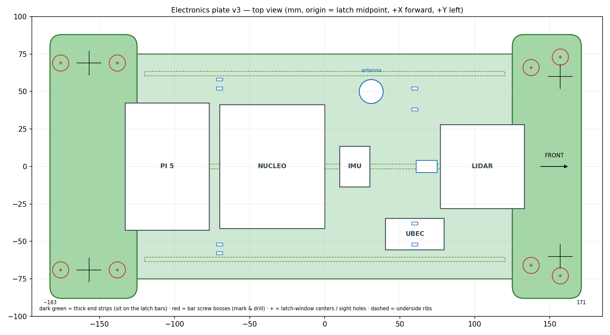

# Electronics plate

One printed PETG plate that replaces the Slash's body. The two stock body-latch **bars** screw to
its underside, so it clicks onto the chassis towers exactly like the body. Pi 5, Nucleo, BNO055,
UBEC and RPLIDAR C1 mount on top. Parametric OpenSCAD:
[`electronics_plate.scad`](electronics_plate.scad). Measurements it's built from:
[`docs/hardware.md`](../../docs/hardware.md) → "Measured: body mounts and clearances".

**Status (v3):** front and rear corner tests passed on the real bars. Full plate submitted
2026-10-18 to Atrium full serve (Prusa XL).

Frame matches ROS: origin = midpoint of the four latch-window centers, +X forward, +Y = car's left.
The plate is **not** centered on the latches: it runs from X = −183 to +171, because the rear bar's
screw ears reach ±18.9 mm fore/aft and the front bar's only reach backward. The end strips rest on
the bars (top of the bars = 135 mm above the floor, level front to rear; the bars make up the
3 mm tower-height difference), so the main plate underside is at ~137 mm.

## Print

- **Prusa XL** (354 × 176 mm part, too long for MK4/Core One beds). **PETG** preferred; PLA is
  acceptable for indoor driving.
- 3.5 mm plate (5.5 mm at the end strips). **Print TOP FACE DOWN** (the flat side with the
  engraved outlines on the bed; ribs and end strips facing up). No supports needed.
  4 perimeters, 30–40 % infill, 0.2 mm layers.
- **Tight fit lengthwise:** 354 mm on a ~356–360 mm bed. Long side along the bed's long axis;
  a full brim won't fit.
- Atrium full-serve submission: Project tab → "…" → Print → **Full Serve: Large Prints**. Staff
  slice it; settings go in the job note:
  > PETG. Top face down (engraved side on bed), no supports. 354×176 mm, tight fit, long side
  > along 360 axis, no room for brim. 4 perimeters, 30–40% infill, 0.2 mm layers.
- Fit checks: `part = "corner_tests"` puts both test pieces in one STL (small, any printer,
  PLA fine). The bigger piece goes on the rear-left latch, the smaller on the front-left. Line the
  sight hole up over the latch-window center and check that both screw bosses land on the piece. The
  rear bumper-side boss is the tightest (~1.7 mm margin).
- The STL keeps the car's coordinates, so it imports off-center: **Center** + **On bed** in the slicer.

**v2 → v3:** the v2 corner test showed the bars' screw holes reach farther than v2 assumed.
v3 shifts the plate rearward (same 354 mm) and lengthens both thick end strips inward to
|X| = 125.

## Assembly (mark and drill)

No screw holes are printed. The real parts locate their own holes:

1. **Latch bars:** clip both bars onto the car. Dab a marker on each of the 8 screw ears. Lower
   the plate straight down onto them and press. Drill **1/8" (3.2 mm)** at each mark (1/16"
   pilot first, **low speed** so PETG cuts instead of melting).
   **M3 × 20 screw from below** through the bar's ear (head under the ear, where the stock screws
   went), up through the plate, **washer + M3 nyloc nut on top**. The bar's 6.46 mm counterbore
   faces up and just sits empty under the plate. Every hole is a clearance hole; the nut does all
   the holding.
2. **Electronics:** set each part inside its engraved outline, mark through its own mounting holes,
   drill (**7/64" ≈ 2.8 mm** for M2.5, **1/8"** for M3). LiDAR on M2.5 standoffs, screws ≤ 4 mm
   into its base. Metal standoffs are fine.
3. **Antenna:** the receiver's antenna tube passes through the 16 mm hole.
4. Check the LiDAR is level once everything is mounted; fine-tune with washers under its standoffs.
5. Shake test: if the plate rattles in the latches, add a thin foam strip between bar and tower.

## Notes

- Under-plate clearance ≈ 22 mm over the receiver/servo; ribs are 6 mm and stop short of the strips.
- The antenna tube pokes ~8 mm above the LiDAR scan plane. Remove its returns with a
  `laser_filters` box filter (robot self-filter); don't pull the tube.
- End strips are 176 mm wide (= inside tire gap), and tires sit ~29 mm below the plate. Checked:
  the front tire doesn't touch at full lock with the suspension compressed.
- The fuse holder sits next to the harness's J1 splice under the plate, not on top (keeps the
  unfused wire short), so the "fuse holder" zip-tie slots are free for cable routing.
